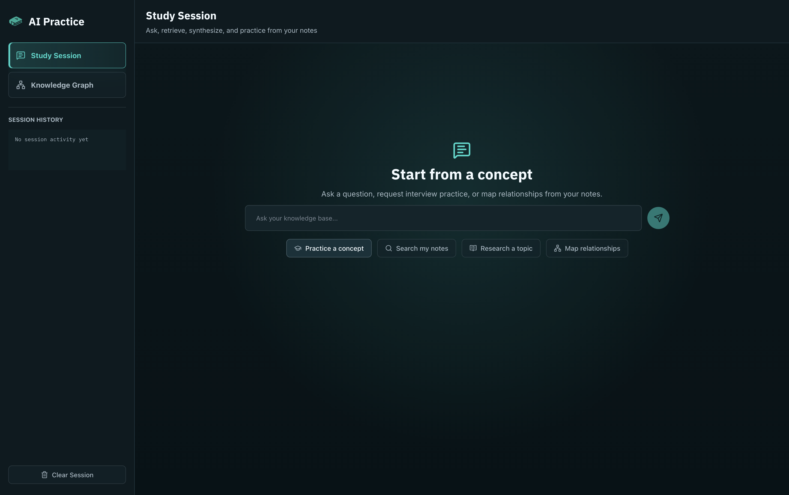
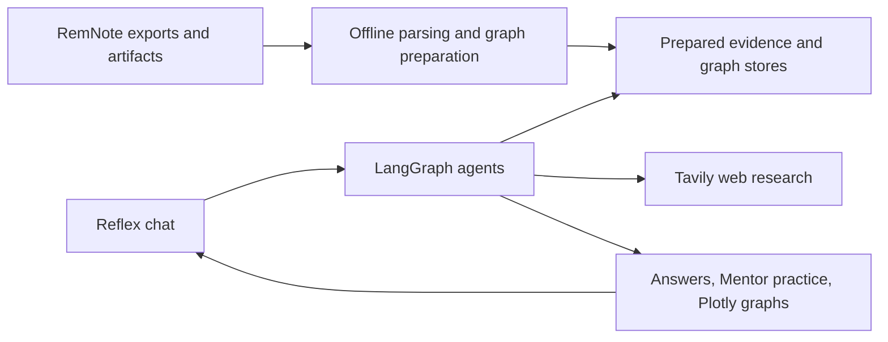
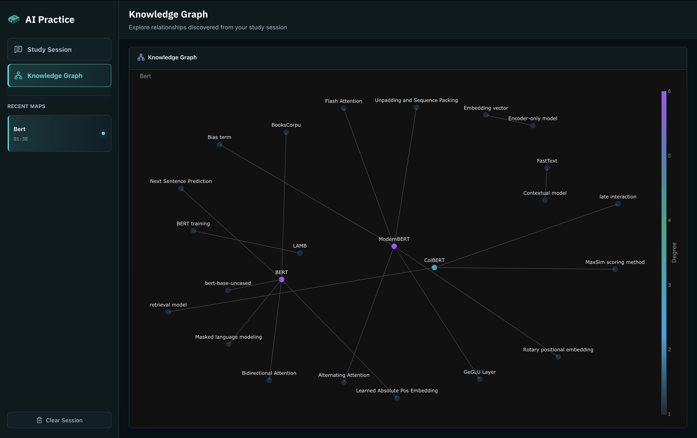
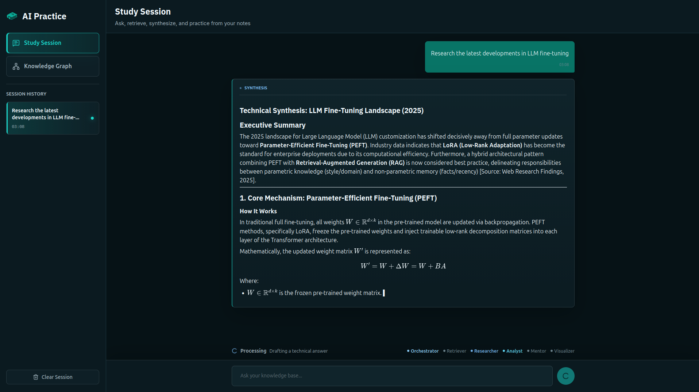
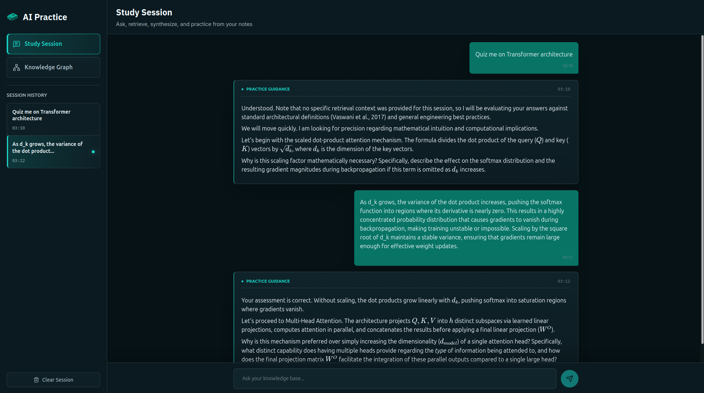

# RemNote Graph RAG | AI Practice System

[](https://www.python.org/downloads/)
[](https://github.com/langchain-ai/langgraph)
[](https://developers.llamaindex.ai/python/framework/)
[](https://reflex.dev/)
[](https://ollama.com/)
[](https://cloud.google.com/run)

A learning and technical interview practice app for developers working with a
personal RemNote knowledge base. It turns exported notes into searchable evidence
and a concept graph, then supports explanations, web research, guided practice,
and interactive graph exploration through chat.

## [Live Demo](https://remnote-graph-rag-frontend-875003222198.europe-west1.run.app/)



The backend uses **Python, LangGraph, and LlamaIndex**; the web interface uses
**Reflex and Plotly**. Storage adapters support local files, Redis, Pinecone,
MongoDB, Neo4j, and Memgraph; deployment uses Google Cloud Run.

The default LLM pipeline uses OpenRouter `openrouter/free` automatic routing;
the pipeline selector retains `ollama` as a compatibility alias.



Preparation runs ahead of serving; application startup loads prepared storage.
Analyst retrieval defaults to `legacy_vector_context`; Visualizer retrieval uses
`optimized`. The default stores combine local files, Redis, Pinecone, and MongoDB.
See the [architecture and configuration](docs/project_overview.md) for decisions,
active prompts, optional backends, and limitations. Knowledge searches use
explicit named-topic or in-scope broad policies; broad mode does not guarantee
that every retrieved result is relevant.

<details>
<summary><strong>More application screenshots — click to expand</strong></summary>





</details>

For a supported Python 3.11 environment with **uv 0.12.3**, install the locked
checks and run the offline suite:

```bash
uv sync --locked --group dev --group evaluation
uv run --no-sync python scripts/check_offline.py
```

The suite uses synthetic data and mocked model/embedding calls; prepared-storage
integration checks are explicitly skipped by default. It needs no `.env`,
credentials, private corpus, downloaded models, or services. See
[setup, usage, and offline gates](docs/project_overview.md#setup-and-offline-checks)
for the complete commands and integration boundary.

Live and judge evaluation require explicit provider confirmation, a fresh quota
observation, and a durable local request guard. See the
[request guard](docs/runtime_evaluation.md#evaluation-request-guard) for limits
and the operator's responsibility to verify external quota.

## Evaluation results

The [complete latest evaluation report](reports/evaluation/latest.md) describes
controlled observations from October 2026, not every later code revision:

- **Runtime compliance:** 10 of 12 completed observations passed their
  deterministic contracts; two failed and three of 15 planned were interrupted.
- **Retrieved evidence:** frozen Precision@10 averaged 33.57% for source-only
  retrieval and 34.29% for graph-assisted retrieval (21 observations each).
  These scores measure reviewed source support, not answer correctness.
- **Generated-answer quality:** unmeasured. The single attempted judge request
  returned HTTP 429; three other eligible assessments were unstarted.

The tested routing/retrieval prompt versions, original evaluator identities,
separate populations, missing usage and limitations are in the complete report.
The sample does not establish a general graph advantage or production quality.

| Documentation | Purpose |
| --- | --- |
| [Project overview](docs/project_overview.md) | Architecture, configuration and offline checks |
| [Data pipeline runbook](docs/optimized_pipeline_runbook.md) | Preparing storage and starting the app |
| [Evaluation evidence](reports/evaluation/README.md) | Latest results, history, methodology and publication instructions |
