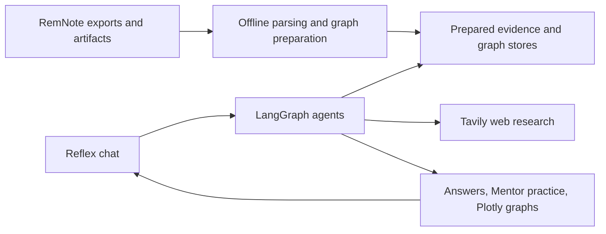

# RemNote Graph RAG | AI Practice System

[](https://www.python.org/downloads/)
[](https://github.com/langchain-ai/langgraph)
[](https://developers.llamaindex.ai/python/framework/)
[](https://reflex.dev/)
[](https://cloud.google.com/run)

A learning and technical interview practice app for developers working with a personal [RemNote](https://www.remnote.com) knowledge base. It turns exported notes into searchable evidence and a concept graph, then supports explanations, web research, guided practice, and interactive graph exploration through chat.

## [Live Demo](https://remnote-graph-rag-frontend-875003222198.europe-west1.run.app/) (paused)


The backend uses **Python, [LangGraph](https://github.com/langchain-ai/langgraph), and [LlamaIndex](https://developers.llamaindex.ai/python/framework/)**; the web interface uses **[Reflex](https://github.com/reflex-dev/reflex) and [Plotly](https://plotly.com/)**. Storage adapters support local files, [Redis](https://redis.io/), [Pinecone](https://www.pinecone.io/), [MongoDB](https://www.mongodb.com/), [Neo4j](https://neo4j.com/), and [Memgraph](https://memgraph.com/); deployment uses [Google Cloud Run](https://cloud.google.com/run).

The default LLM pipeline uses [OpenRouter](https://openrouter.ai/) `openrouter/free` automatic routing; the pipeline selector retains [Ollama](https://ollama.com/library?sort=newest) `ollama` as a compatibility alias.



Preparation runs ahead of serving; application startup loads prepared storage. Analyst retrieval defaults to `legacy_vector_context`; Visualizer retrieval uses `optimized`. The default stores combine local files, Redis, Pinecone, and MongoDB. See the [architecture and configuration](docs/project_overview.md) for decisions, active prompts, optional backends, and limitations. Knowledge searches use explicit named-topic or in-scope broad policies; broad mode does not guarantee that every retrieved result is relevant.

<details>
<summary><strong>More application screenshots — click to expand</strong></summary>


</details>

For a supported Python 3.11 environment with **uv 0.12.3**, install the locked checks and run the offline suite:

```bash
uv sync --locked --group dev --group evaluation
uv run --no-sync python scripts/check_offline.py
```

The suite uses synthetic data and mocked model/embedding calls; prepared-storage integration checks are explicitly skipped by default. It needs no `.env`, credentials, private corpus, downloaded models, or services. See [setup, usage, and offline gates](docs/project_overview.md#setup-and-offline-checks) for the complete commands and integration boundary.

Live and judge evaluation require explicit provider confirmation, a fresh quota observation, and a durable local request guard. See the [request guard](docs/runtime_evaluation.md#evaluation-request-guard) for limits and the operator's responsibility to verify external quota.

## Evaluation results

The [evaluation overview](reports/evaluation/README.md) and [detailed system report](reports/evaluation/latest.md) describe historical August and October 2026 observations, not every later code revision. August recorded 6 / 12 imported-trace passes and 10 / 15 live passes. October recorded 10 / 12 completed live passes, two failures, and three interrupted executions out of 15 planned. These are deterministic contract results, not answer-quality scores. October judge quality is unavailable after one HTTP 429; three other eligible assessments were unstarted.

The [separate optimization experiment](reports/evaluation/experiments/README.md) compares retrieval variants and does not supply system-evaluation scores.

| Documentation | Purpose |
| --- | --- |
| [Project overview](docs/project_overview.md) | Architecture, configuration and offline checks |
| [Data pipeline runbook](docs/optimized_pipeline_runbook.md) | Preparing storage and starting the app |
| [Evaluation evidence](reports/evaluation/README.md) | Latest results, history, methodology and publication instructions |
