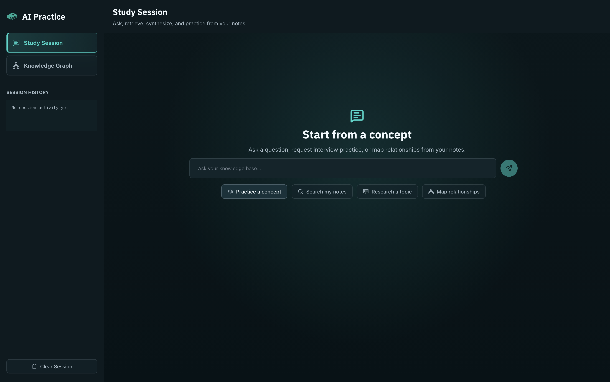
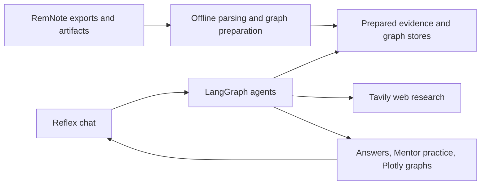
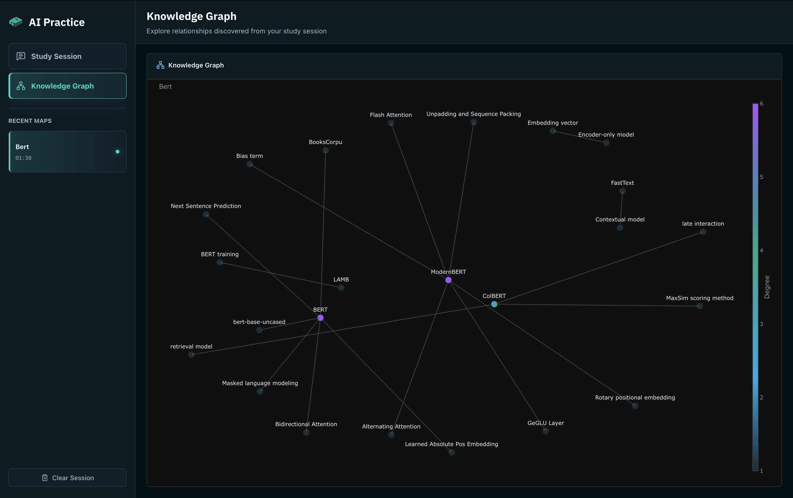
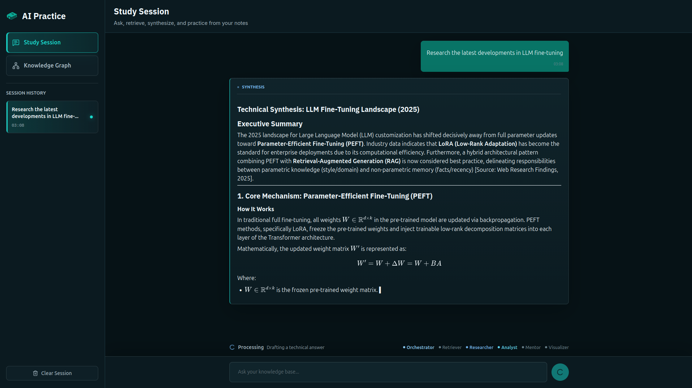
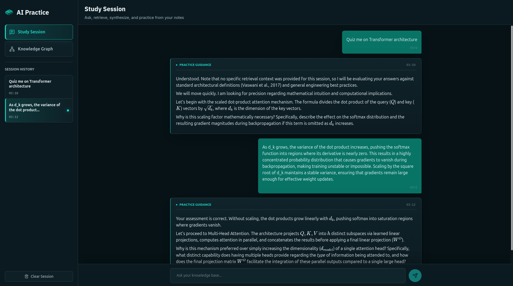

# RemNote Graph RAG | AI Practice System

[](https://www.python.org/downloads/)
[](https://github.com/langchain-ai/langgraph)
[](https://developers.llamaindex.ai/python/framework/)
[](https://reflex.dev/)
[](https://ollama.com/)
[](https://cloud.google.com/run)

A learning and technical interview practice app for developers working with a
personal RemNote knowledge base. It turns exported notes into searchable evidence
and a concept graph, then supports explanations, web research, guided practice,
and interactive graph exploration through chat.

## [Live Demo](https://remnote-graph-rag-frontend-875003222198.europe-west1.run.app/)



The backend uses **Python, LangGraph, and LlamaIndex**; the web interface uses
**Reflex and Plotly**. Storage adapters support local files, Redis, Pinecone,
MongoDB, Neo4j, and Memgraph; deployment uses Google Cloud Run.

Ollama is the intended primary LLM backend. The public demo currently uses
OpenRouter `openrouter/free` automatic routing to keep operating costs low.



Preparation runs ahead of serving; application startup loads prepared storage.
Analyst retrieval defaults to `legacy_vector_context`; Visualizer retrieval uses
`optimized`. The default stores combine local files, Redis, Pinecone, and MongoDB.
See the [architecture and configuration](docs/project_overview.md) for decisions,
active prompts, optional backends, and limitations.

<details>
<summary>More application screenshots</summary>





</details>

For a supported Python 3.11 environment with **uv 0.12.3**, install the locked
checks and run the offline suite:

```bash
uv sync --locked --group dev --group evaluation
uv run --no-sync python scripts/check_offline.py
```

The suite uses synthetic data and mocked model/embedding calls; prepared-storage
integration checks are explicitly skipped by default. It needs no `.env`,
credentials, private corpus, downloaded models, or services. See
[setup, usage, and offline gates](docs/project_overview.md#setup-and-offline-checks)
for the complete commands and integration boundary.

The published evaluation is **historical and incomplete**; it does not measure
current answer quality or establish an improvement from graph retrieval. Updated
configuration capture changes future evaluation fingerprints; see the
[evaluation provenance contract](docs/runtime_evaluation.md#immutable-history-and-fingerprints).

| Documentation | What to assess |
| --- | --- |
| [Project overview](docs/project_overview.md) | Architecture, model/storage defaults, setup, testing, design boundaries |
| [Data pipeline runbook](docs/optimized_pipeline_runbook.md) | Preparing storage and starting the app |
| [Evaluation guide](docs/runtime_evaluation.md) | Contracts, metric definitions, provenance, and limitations |
| [Published evidence](reports/evaluation/README.md) | Historical scorecards and their missing coverage |
| [Full report runbook](docs/full_evaluation_report_runbook.md) | Asset/service-dependent evaluation and explicit publication |
| [Approved improvement plan](docs/portfolio_improvement_plan.md) / [execution report](docs/portfolio_execution_report.md) | Scope and local implementation verification |
