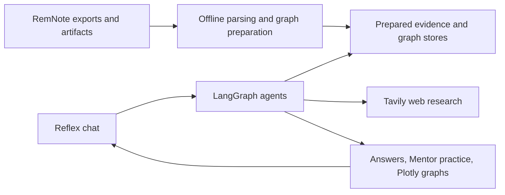

# RemNote Graph RAG | AI Practice System

[](https://www.python.org/downloads/)
[](https://github.com/langchain-ai/langgraph)
[](https://developers.llamaindex.ai/python/framework/)
[](https://reflex.dev/)
[](https://ollama.com/)
[](https://cloud.google.com/run)

A learning and technical interview practice app for developers working with a
personal RemNote knowledge base. It turns exported notes into searchable evidence
and a concept graph, then supports explanations, web research, guided practice,
and interactive graph exploration through chat.

## [Live Demo](https://remnote-graph-rag-frontend-875003222198.europe-west1.run.app/)


The backend uses **Python, LangGraph, and LlamaIndex**; the web interface uses
**Reflex and Plotly**. Storage adapters support local files, Redis, Pinecone,
MongoDB, Neo4j, and Memgraph; deployment uses Google Cloud Run.

Ollama is the intended primary LLM backend. The public demo currently uses
OpenRouter `openrouter/free` automatic routing to keep operating costs low.



Preparation runs ahead of serving; application startup loads prepared storage.
Analyst retrieval defaults to `legacy_vector_context`; Visualizer retrieval uses
`optimized`. The default stores combine local files, Redis, Pinecone, and MongoDB.
See the [architecture and configuration](docs/project_overview.md) for decisions,
active prompts, optional backends, and limitations. Knowledge searches use
explicit named-topic or in-scope broad policies; broad mode does not guarantee
that every retrieved result is relevant.

<details>
<summary><strong>More application screenshots — click to expand</strong></summary>


</details>

For a supported Python 3.11 environment with **uv 0.12.3**, install the locked
checks and run the offline suite:

```bash
uv sync --locked --group dev --group evaluation
uv run --no-sync python scripts/check_offline.py
```

The suite uses synthetic data and mocked model/embedding calls; prepared-storage
integration checks are explicitly skipped by default. It needs no `.env`,
credentials, private corpus, downloaded models, or services. See
[setup, usage, and offline gates](docs/project_overview.md#setup-and-offline-checks)
for the complete commands and integration boundary.

Live and judge collection require explicit authorization and a persistent shared
budget; CLI confirmation flags alone do not authorize calls. The current policy
allows up to 50 attempts/day and B0/final allocations of 33/59 within 92 overall.
Existing 24-policy ledgers require an explicit reviewed amendment; an existing
day limit remains binding unless accepted historical-origin or fresh prospective
capacity evidence supports a change. Resumed final runs require an explicitly
registered fresh quota observation and retain its capture-bound baseline.
B0 preserves the
current OpenRouter deployment. See the
[collection limits and readiness boundary](docs/runtime_evaluation.md#portfolio-collection-budgets-and-b0-checkpoint).

Runtime token metrics report availability and coverage, including unknown usage;
they are not complete billing totals. See the
[usage accounting method](docs/runtime_evaluation.md#token-usage-availability).

The published evaluation is **historical and incomplete**; it does not measure
current answer quality or establish an improvement from graph retrieval. Updated
configuration capture changes future evaluation fingerprints; see the
[evaluation provenance contract](docs/runtime_evaluation.md#immutable-history-and-fingerprints). The [optional fixed-judge pilot](docs/runtime_evaluation.md#optional-semantic-judges) pins observed serving identity and shares one counted transient retry across four assessments; it has separate execution prerequisites, including a registered model-specific quota.

| Documentation | What to assess |
| --- | --- |
| [Project overview](docs/project_overview.md) | Architecture, model/storage defaults, setup, testing, design boundaries |
| [Data pipeline runbook](docs/optimized_pipeline_runbook.md) | Preparing storage and starting the app |
| [Evaluation guide](docs/runtime_evaluation.md) | Contracts, metric definitions, provenance, and limitations |
| [Retrieval comparison](docs/retrieval_ablation.md) | Local graph and reranker findings and their limits |
| [Controlled final report](reports/evaluation/portfolio_final_20261031.md) | Current saved runtime outcomes, retrieval evidence, partial judge pilot and limitations |
| [Published evidence](reports/evaluation/README.md) | Historical scorecards and their missing coverage |
| [Full report runbook](docs/full_evaluation_report_runbook.md) | Asset/service-dependent evaluation and explicit publication |
| [Collection budgets and B0 checkpoint](docs/runtime_evaluation.md#portfolio-collection-budgets-and-b0-checkpoint) | Explicit authorization, shared attempt limits, and baseline claim limits |
